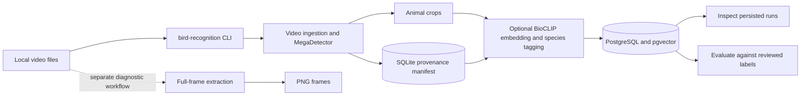

# Bird Recognition

A trail-camera bird-footage search and question-answering project. The implemented
workflows ingest local video, retain animal crops with provenance, optionally
suggest species tags for crops, and provide a diagnostic full-frame extractor.
Species tags are candidate-relative suggestions, not verified biological
identifications. See [Usage](docs/usage.md) for operational guidance and
[Development](docs/development.md) for contributor setup and checks.

## Main components

Ingestion and frame extraction operate on local video. Crop embedding and species
tagging are an optional downstream workflow; they do not replace or modify the
ingestion manifest or crops. PostgreSQL/pgvector stores embedding runs and
species decisions for later inspection and evaluation.

## Video ingestion

The `bird-recognition ingest` command scans local video directories recursively
and writes animal crops with a SQLite provenance manifest. The selected detector
is the MIT-licensed MegaDetector V6 variant `MDV6-mit-yolov9-c`. Provision its
`.ckpt` weights and `config_v9s.yaml` locally, outside Git; ingestion requires
both local files and never downloads model weights or configuration.

Keep input footage and output outside the Git repository and make them disjoint.
Supported extensions are `.mp4`, `.mov`, `.m4v`, `.mkv`, `.avi`, `.mpeg`, and
`.mpg`. Sampling defaults to one second; animal and person confidence thresholds
default to `0.2` and qualify inclusively. Person detection is not a guarantee of
anonymity: review crops manually before sharing them.

See [Usage](docs/usage.md#ingest-local-videos) for the command and configuration,
and the [ingestion quickstart](specs/001-ingest-videos/quickstart.md) and
[CLI contract](specs/001-ingest-videos/contracts/cli.md) for feature details and
validation.

## Crop embeddings and species tags

Indexing is an optional local workflow layered on ingestion. Its model assets,
candidate lists, evaluation labels, and reports are private files that must remain
outside Git. Species confidence is candidate-relative rather than a calibrated
probability of biological correctness; review measured errors before relying on
tags or publishing quality claims.

See [Usage](docs/usage.md#crop-embeddings-and-species-tags) for the workflow and
the [crop-embedding quickstart](specs/002-embed-species-tags/quickstart.md) for
provisioning, feature validation, and measured evaluation evidence.

## Documentation

- [Usage and local workflows](docs/usage.md): ingestion, frame extraction,
  database, indexing, inspection, and evaluation.
- [Developer setup and checks](docs/development.md): environment, tests, lint,
  formatting, CI, and AI-assisted development.
- [Ingestion feature documents](specs/001-ingest-videos/): requirements, design,
  contracts, quickstart, and validation evidence.
- [Embedding and species-tag feature documents](specs/002-embed-species-tags/):
  requirements, design, contracts, quickstart, and validation evidence.
