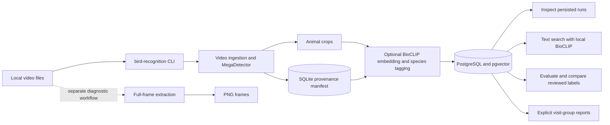

# Bird Recognition

A tool for working through large collections of trail-camera footage. The camera's
motion detection also triggers on wind-blown branches, so many clips contain no
animal at all. The project has two goals:

1. **Flag empty videos.** Detect whether a clip contains an animal so clips
   without one can be set aside. This is a goal only: it is not yet planned or
   implemented, and detection can miss animals, so "empty" would mean "likely
   empty, to be reviewed".
2. **Identify bird species.** Suggest species for the animals found in videos.

Implemented today: video ingestion that detects animals and retains crops with
provenance, optional species-tag suggestions for crops, text search over indexed
crops, and a diagnostic full-frame extractor. Possible future extras include
grounded question answering over the footage (Ask/RAG); there is no
implemented answer-generation command.

Species tags are candidate-relative suggestions, not verified biological
identifications. See [Usage](docs/usage.md) for operational guidance and
[Development](docs/development.md) for contributor setup and checks.

## Main components

Ingestion and frame extraction operate on local video. Crop embedding and species
tagging are an optional downstream workflow; they do not replace or modify the
ingestion manifest or crops. PostgreSQL/pgvector stores embedding runs and
species decisions for inspection, text search, and derived reports. Reference-assisted
classification is opt-in; visits use explicit owner-reviewed groups and never
replace per-crop decisions. Model benchmarking performs capped local inference.

## Video ingestion

The `bird-recognition ingest` command scans local video directories recursively
and writes animal crops with a SQLite provenance manifest. The selected detector
is the MIT-licensed MegaDetector V6 variant `MDV6-mit-yolov9-c`. Provision its
`.ckpt` weights and `config_v9s.yaml` locally, outside Git; ingestion requires
both local files and never downloads model weights or configuration.

Keep input footage and output outside the Git repository and make them disjoint.
Supported extensions are `.mp4`, `.mov`, `.m4v`, `.mkv`, `.avi`, `.mpeg`, and
`.mpg`. Sampling defaults to one second; animal and person confidence thresholds
default to `0.2` and qualify inclusively. Person detection is not a guarantee of
anonymity: review crops manually before sharing them.

See [Usage](docs/usage.md#ingest-local-videos) for the command and configuration,
and the [ingestion quickstart](specs/001-ingest-videos/quickstart.md) and
[CLI contract](specs/001-ingest-videos/contracts/cli.md) for feature details and
validation.

## Crop embeddings and species tags

Indexing is an optional local workflow layered on ingestion. Its model assets,
candidate lists, evaluation labels, and reports are private files that must remain
outside Git. Species confidence is candidate-relative rather than a calibrated
probability of biological correctness; review measured errors before relying on
tags or publishing quality claims.

See [Usage](docs/usage.md#crop-embeddings-and-species-tags) for the workflow and
the [crop-embedding quickstart](specs/002-embed-species-tags/quickstart.md) for
provisioning, feature validation, and measured evaluation evidence.

## Documentation

- [Usage and local workflows](docs/usage.md): ingestion, frame extraction,
  database, indexing, inspection, search, and classification-quality workflows.
- [Developer setup and checks](docs/development.md): environment, tests, lint,
  formatting, CI, and AI-assisted development.
- [Ingestion feature documents](specs/001-ingest-videos/): requirements, design,
  contracts, quickstart, and validation evidence.
- [Embedding and species-tag feature documents](specs/002-embed-species-tags/):
  requirements, design, contracts, quickstart, and validation evidence.
- [Text-search feature documents](specs/003-search-crops/): read-only retrieval,
  metadata filters, score interpretation, and validation scenarios.
- [Classification-quality feature documents](specs/004-improve-species-classification/):
  crop/input preparation, shared labels, comparisons, references, benchmarks,
  and explicit visit aggregation. Implemented interfaces do not imply measured
  biological quality.
